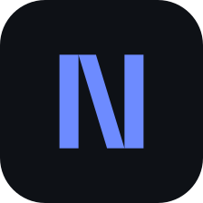

<div align="center">
  
  <h1>Neuxie</h1>

  <p><strong>A fast, fully featured browser and work environment,<br />built for Linux.</strong></p>

  <p>
    <a href="LICENSE"></a>
    
  </p>
</div>

Neuxie is a source fork of [Zephium](https://github.com/zephium-browser/Zephium)
that adds an experimental Linux build. It is the same browser: Rust on your
operating system's own web engine, not a fork of Chromium or Firefox. On Linux
it uses the system GTK 3 and WebKitGTK 4.1; on macOS and Windows it is upstream's
WebKit and WebView2 build unchanged. It blocks ads and trackers natively, runs
Chrome extensions on the platforms that have a WebExtension runtime, and puts
tasks, notes and your time on the web in one place.

Neuxie is **not affiliated with, endorsed by, or supported by the Zephium
project**. Upstream wrote essentially all of this code; see [NOTICE](NOTICE) for
attribution. The product name, identifier and icons were renamed for this fork.

## Build on Linux

Prerequisites:

- Rust 1.99 or newer, and the Node/pnpm versions pinned in `.node-version` and
  `package.json`
- GTK 3 and WebKitGTK 4.1 with its development headers
- `libayatana-appindicator` (Arch: `libappindicator`), `libsecret`
- GStreamer and its plugins, for media playback
- The usual build tools (`gcc`, `pkg-config`, `patchelf`), plus `bwrap` and
  `xdg-dbus-proxy` for the bundle and for running it (`bubblewrap`,
  `xdg-dbus-proxy` on Arch)

```sh
pnpm install --frozen-lockfile
NO_STRIP=1 pnpm -C desktop build --bundles appimage
```

The command yields
`target/release/bundle/appimage/app.neuxie_1.0.3_amd64.AppImage` — the file name
is the application id, the version in `tauri.conf.json`, and the Debian
architecture, because the bundler derives it from the Linux `productName` (which
must stay `app.neuxie` so the installed entry is `app.neuxie.desktop`).

`NO_STRIP=1` is required where the distro's binutils emit `.relr.dyn` sections:
the `strip` that ships inside linuxdeploy cannot read them and aborts the
bundle. The post-bundle step in `scripts/patch-appimage-sandbox.mjs` repairs the
library paths linuxdeploy relocates and repacks the image; without it the
AppImage dies at startup because WebKitGTK cannot find `bwrap`.

A plain development build is `cargo build -p zephium-desktop` (debug binaries
load the frontend from `http://localhost:1420`, so run `pnpm --dir frame dev`
alongside them).

## Run

```sh
./target/release/bundle/appimage/app.neuxie_1.0.3_amd64.AppImage
```

If FUSE is unavailable (common in containers and some minimal installs), unpack
and run instead:

```sh
./app.neuxie_1.0.3_amd64.AppImage --appimage-extract-and-run
```

The bundled WebKitGTK stays sandboxed, so the host must provide `bwrap` and
`xdg-dbus-proxy` (Arch: `bubblewrap`, `xdg-dbus-proxy`).

On Wayland systems with a proprietary NVIDIA driver, a page may stay blank
because of the GBM/dmabuf path. Launch with `WEBKIT_DISABLE_DMABUF_RENDERER=1`
set in the environment to render through the fallback. That is a local
workaround for this machine class, not something the shipped desktop entry sets.

This fork does not ship signed auto-updates yet, so updates are manual: re-download the newer AppImage from the releases page.

## Changes from upstream

- **Linux port.** Upstream refuses Linux at two gates; this fork carries the
  upstream contributor's unmerged gate fix (PR #221) plus the follow-up fixes
  needed to compile and link the desktop shell against GTK 3 and WebKitGTK 4.1.
- **Rebrand.** Application name `Neuxie`, identifier `app.neuxie`, new icons,
  wordmark and user-facing strings. The installed desktop entry is
  `app.neuxie.desktop` so the GTK application id and the portal registry id stay
  on one value.
- **Updates and links** point at this repository's releases and issues, never at
  upstream's, so an updated install can never be replaced by an upstream binary.

## Known Linux gaps

Not yet implemented or qualified on Linux:

- Native download transport
- Extension hosting: WebKitGTK has no native WebExtension runtime
- Ask's native page reader
- Work's native browser adapters
- Application credentials through Secret Service
- A qualified sandbox for Work command execution

Window behaviour, global shortcuts and the rest of the desktop integration are
unqualified across X11 and Wayland compositors: treat a Linux build as a
developer preview, not a release.

## License

Neuxie is distributed under the same terms as upstream: the Mozilla Public
License 2.0 (`MPL-2.0`), with the bundled blocker seed lists under
CC-BY-SA-3.0. See [LICENSE](LICENSE), [NOTICE](NOTICE) and
`assets/blocker-seed/v1/NOTICE`.
